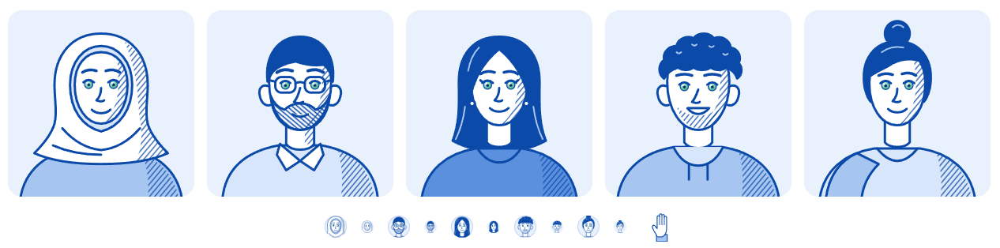

## Overview

PrimeOMS avatars look like **blue-and-white porcelain**: one cobalt ink does all the drawing and all the shading. Faces stay white. The only other colour is a small **pearl-green iris** that makes each face feel alive. The style is friendly and hand-made, a deliberate counterweight to the precise product UI around it.

Each colour has one job:
- **Blue draws.** Lines, hatching, hair and clothing are all blue, using one ink and three tints.
- **White is the light.** Skin, collars, headscarves, teeth and earrings are pure white.
- **Pearl green is life.** It is used only in the eyes.

The avatars are SVG `<symbol>`s with no hardcoded colour. Every fill and stroke comes from a CSS class mapped to a `--av-*` token. **Change the tokens and the whole cast recolours.**

## Palette

| Token | Hex | Role |
|---|---|---|
| `--av-ink` | `#0b4aa8` | Every outline, every hatch line, all hair |
| `--av-ink-deep` | `#072d66` | Pupils only |
| `--av-bg` | `#e8f1fc` | Ground behind avatars: circles, quote cards, preview tiles |
| `--av-skin` | `#ffffff` | Skin and all "white" details: collars, headscarf, teeth, earrings |
| `--av-tint-1` | `#d7e6fa` | Light cloth, scarf inner band, hood lining |
| `--av-tint-2` | `#a6c6f1` | Mid cloth, hair sheen strands |
| `--av-tint-3` | `#5b90df` | Strong cloth. Use it on one person per group at most |
| `--av-eye` | `#6fcaa8` | Pearl green, the iris body |
| `--av-eye-sheen` | `#e6f8f1` | The pearl highlight at the iris centre |
| `--av-eye-deep` | `#3a9f7f` | Iris rim, which defines the edge |
| `--av-quote` | `#0a3f8f` | Quote text on `--av-bg` (about 8.7:1 contrast) |

**Rules**
- **No black, anywhere.** The darkest value is `--av-ink-deep`, and it appears only in pupils.
- **No other hues.** No browns, reds or skin tones. Skin is white; the drawing carries the form.
- **Pearl green is for eyes.** The one sanctioned exception is the flower centres in the announcement-bar doodle (`.d-center`), which belongs to the same illustration family.
- **Tints are cloth, not shading.** Shadows are always hatch lines in `--av-ink`, never a darker fill.

## Anatomy

All portraits are drawn on a **120 × 120** canvas, head and shoulders, front-facing, centred on `x = 60`.

| Feature | Position (canvas units) |
|---|---|
| Crown | y ≈ 17–21 (hair or scarf can rise to 14) |
| Brows | y ≈ 39–42 |
| Eye line | y ≈ 47.8–49.2; centres 15–19 units apart (e.g. x = 52 and 68) |
| Nose | x ≈ 56–62, y ≈ 50–59: one hooked stroke, no nostrils |
| Mouth | y ≈ 63–67: one smile arc, or an open smile filled white |
| Chin | y ≈ 73–77 |
| Face width | about 34–40 units (x ≈ 40–80) |
| Ears | x ≈ 34–40 and 80–86, y ≈ 49–61 (hidden by long hair or a scarf) |
| Neck | x ≈ 51–69, y ≈ 68–86 |
| Shoulders | Torso starts at y ≈ 87–89, spans the full width and **bleeds off the bottom edge** (y = 121) |

**Light comes from the upper left.** Shading always sits on the viewer's right: the right cheek and jaw, the right side of the neck, the right shoulder, and the right fall of a scarf.

## Linework

- One ink (`--av-ink`), with round caps and round joins.
- **1.5** for outlines and features, **1.8–2.0** for brows, **0.6** for the iris ring, and **1.0** for hair-sheen strands.
- Lines are confident and simple. Don't draw wrinkles, nostrils, lip outlines or teeth separations. A face is two brows, two eyes, one nose stroke and one mouth.

## Shading (hatch)

Shading is done with two patterns defined once in the sprite and drawn in `--av-ink`:

| Pattern | Angle | Spacing | Line | Use |
|---|---|---|---|---|
| `url(#hatch)` | 40° | 2.6 | 0.6 | Shadow side of face, neck, clothing, scarf |
| `url(#hatch-x)` | −50° | 2.2 | 0.8 | Dense texture: beards and stubble |

- A shadow is a **crescent shape with `stroke="none"`**, placed straight after the shape it shades.
- At 16–28px the hatching reads as a soft blue tone. At 120px and up it reads as engraving. Both are intended.
- Never shade with a darker tint fill, a gradient or opacity.

## Eyes (the pearl detail)

Eyes are always **open**, because the green has to be visible. Draw them in this order, so the lid overlaps the top of the iris:

| Layer | Spec |
|---|---|
| Iris | `r = 2.6`, class `f-eye` (fill `url(#av-pearl)`), ring `stroke-width = .6` |
| Pupil | `r = .9`, class `f-pupil`, offset +0.2 down from the iris centre |
| Glint | `r = .5`, class `f-glint` (white), offset (−0.9, −1.0): upper left, matching the light |
| Upper lid | A 1.5 stroke arc about 6.4–6.8 wide, apex just above the iris top. Lashes are optional (Ayesha has one flick per eye) |

The pearl gradient (`#av-pearl`) is radial, centred at 36% / 32% with radius 78%. Its stops are `--av-eye-sheen` at 0, `--av-eye` at .55 and `--av-eye-deep` at 1. That sheen-to-rim falloff is what makes the green read as **pearl** rather than flat mint.

## The cast

| Persona | Symbol | Role on the site | Signature traits | Cloth |
|---|---|---|---|---|
| Nabila | `#av-nabila` | Moderator | White hijab with a `tint-1` inner band and drape folds; gentle smile | `tint-2` dress |
| Tanvir | `#av-tanvir` | Store owner | Short solid hair, `hatch-x` beard, rounded-rectangle glasses, white collar | `tint-1` shirt |
| Ayesha | `#av-ayesha` | Operations | Long centre-parted hair with `tint-2` sheen strands, white stud earrings, lashes | `tint-3` top |
| Rafi | `#av-rafi` | Moderator (invited) | Curly hair cap with sheen flicks, stubble hatch, open white smile | `tint-2` hoodie, `tint-1` hood lining, drawstrings |
| Sadia | `#av-sadia` | Customer (in demos and chats) | Top bun, side-swept fringe, `tint-2` dupatta over one shoulder | `tint-1` kameez |

**Props.** `#av-hand` (viewBox `0 0 40 52`) is a waving hand: white palm, finger separations and a `tint-2` cuff. It is placed beside a lead avatar's shoulder and animated with `.av-wave`. It is the only part of a body that is ever drawn separately.

Keep a group visually balanced. Mix hair shapes (scarf, short, long, curly), give at most one person `tint-3`, and give at most one person glasses.

## Motion

The cast is alive, but in a calm way. Motion stays small, slow, and out of sync, so a crowd of avatars never moves in lockstep. All of it lives in `css/motion.css`, and all of it stops under `prefers-reduced-motion`.

| Motion | Class | Where it applies | Spec |
|---|---|---|---|
| Blink | `.av-eyes` (inside every symbol) | Every avatar, every size | Eyes squash to 8% height toward the lid, at 95% of a 6.5s cycle. `transform-origin: 50% 25%` |
| Glance | `.av-look` (inside every symbol) | Every avatar | Pupils and glints drift 0.7 units left, hold, drift right, return, over a 9s cycle |
| Bob | `.av-bob` (on the outer `<svg>`) | Large avatars only: cast lineup, route pins, chips | 5px lift over 4.6s, ease-in-out. Stagger with `--bob` |
| Wave | `.av-wave` (on `#av-hand`) | One lead avatar per scene | Swing +18° / −10° / +16° / −6° / +8°, then rest. 2.8s cycle, pivoting at the wrist |
| Hello | `.av-hello` | An avatar entering a scene | 0.7s spring up from 14px below, once |

**Rules**
- **Desynchronise.** `js/scenes.js` gives every instance a random negative `--blink` and `--look` delay, so two Nabilas on screen never blink together. Custom properties pass into the `<use>` shadow tree, so this works per instance even though the symbol is shared.
- **Keep faces still.** The face never changes shape. Only the eyes blink and glance; mouths, brows and heads stay fixed. Whole-body motion (bob) moves the entire `<svg>`.
- **One waver per scene.** Never have more than one avatar waving at a time.
- **Avatars are not cursors.** In demos, a teammate's cursor carries their 16px avatar on its name tag, but the avatar itself never flies around the screen.
- **Reduced motion.** Every animation above switches off. The avatar stays fully drawn with open eyes, which is a complete, meaningful still.

## Sizes & crops

| Size | Markup | viewBox | Where it's used |
|---|---|---|---|
| 16px | `<svg class="av av--xs">` | `20 12 80 80` | "by …" tags on orders and drafts, activity log rows |
| 28px | `<svg class="av">` | `20 12 80 80` | Moderator lists and people pickers |
| ~178px | `<svg class="mm-quote__art">` | `0 0 120 120` | Quote cards: anchored bottom-right and running off the card edge |
| ≥ 200px | (tile) | `0 0 120 120` | Feature or preview tiles: an 18px-radius tile on `--av-bg` |

- **Small crops** (16 and 28px) zoom to the head with `viewBox="20 12 80 80"` and sit in a circle on `--av-bg`. The 28px size adds a 1px inset ring in 16% ink.
- **Large placements** show the full bust and always let the shoulders run off the bottom edge. Never float a portrait with empty space beneath it.
- **Below 16px**, don't use an avatar; show the name only.

## Using an avatar in code

The symbols, hatch patterns and pearl gradient live in the **inline SVG sprite at the top of `index.html`**. Keep that sprite inline. Pulled from an external file, `url(#hatch)` and `url(#av-pearl)` break in some browsers.

```html
<!-- 28px circle (16px: add av--xs) -->
<svg class="av" viewBox="20 12 80 80" aria-hidden="true">
  <use href="#av-nabila" width="120" height="120"/>
</svg>

<!-- Full bust in a quote card -->
<svg class="mm-quote__art" viewBox="0 0 120 120" aria-hidden="true">
  <use href="#av-nabila" width="120" height="120"/>
</svg>
```

`width="120" height="120"` on the `<use>` is required. Without it, the crop `viewBox` has nothing to crop.

### Paint classes

The colour classes are defined in `css/styles.css` and mapped to tokens. Inside a symbol, use only these classes, never a hex value:

| Class | Paints | Token |
|---|---|---|
| `.av-line` (on the root `<g>`) | stroke | `--av-ink` |
| `.av-hatch` (inside patterns) | stroke | `--av-ink` |
| `.f-skin`, `.f-white` | fill | `--av-skin` |
| `.f-hair` | fill | `--av-ink` |
| `.f-t1` / `.f-t2` / `.f-t3` | fill | `--av-tint-1` / `-2` / `-3` |
| `.f-eye` | fill | `url(#av-pearl)` |
| `.f-pupil` | fill | `--av-ink-deep` |
| `.f-glint` | fill | `#ffffff` |
| `.s-sheen` | stroke | `--av-tint-2` |
| `.av-pearl-0` / `-1` / `-2` | stop-color | `--av-eye-sheen` / `--av-eye` / `--av-eye-deep` |

`fill="none"`, `stroke="none"` and `fill="url(#hatch)"` / `url(#hatch-x)` stay as attributes.

## Adding a new person

1. Copy the template below into the sprite and give it an `av-<name>` id.
2. Draw back to front, in this layer order:
   1. back hair
   2. torso and torso hatch
   3. neck and neck hatch
   4. neckline or collar
   5. ears
   6. head and face hatch
   7. front hair or scarf
   8. facial hair
   9. brows
   10. eyes (iris, pupil, glint, lid)
   11. nose and mouth
   12. accessories
3. Check it at **28px and 16px** before you use it. The silhouette (hair or scarf shape) must be recognisable at 16px.
4. Add the person to **The cast** table above.

```svg
<symbol id="av-name" viewBox="0 0 120 120">
  <g class="av-line" stroke-width="1.5" stroke-linecap="round" stroke-linejoin="round">
    <!-- torso: bleeds off the bottom -->
    <path class="f-t2" d="M10 121c3-18 16-29 35-32h30c19 3 32 14 35 32z"/>
    <path d="M85 91c11 5 20 14 23 30H88c1-11 0-21-3-30z" fill="url(#hatch)" stroke="none"/>
    <!-- neck -->
    <path class="f-skin" d="M51 70v16c3 5 15 5 18 0V70"/>
    <!-- head + shadow crescent -->
    <path class="f-skin" d="M40 46c0-16 9-26 20-26s20 10 20 26c0 18-9 31-20 31S40 64 40 46z"/>
    <path d="M71 26c6 5 9 12 9 21 0 17-9 30-20 30 7-4 13-14 14-27 1-10-1-18-3-24z" fill="url(#hatch)" stroke="none"/>
    <!-- hair: replace with your silhouette -->
    <path class="f-hair" d="M39 46c-2-17 7-29 21-29s23 12 21 29c-1-5-3-9-6-11-5 1-12 0-18-2-6 1-11 3-14 6-2 2-3 5-4 7z"/>
    <!-- brows -->
    <path d="M46 41c3-2 7-2 10-1M64 40c3-1 7-1 10 1" fill="none" stroke-width="1.8"/>
    <!-- eyes: iris, pupil, glint (grouped for blink + glance), then lid -->
    <g class="av-eyes">
      <circle class="f-eye" cx="51" cy="48.2" r="2.6" stroke-width=".6"/>
      <circle class="f-eye" cx="69" cy="48.2" r="2.6" stroke-width=".6"/>
      <g class="av-look">
        <circle class="f-pupil" cx="51" cy="48.4" r=".9" stroke="none"/>
        <circle class="f-pupil" cx="69" cy="48.4" r=".9" stroke="none"/>
        <circle class="f-glint" cx="50.1" cy="47.2" r=".5" stroke="none"/>
        <circle class="f-glint" cx="68.1" cy="47.2" r=".5" stroke="none"/>
      </g>
    </g>
    <path d="M47.8 46.9c2-1.9 4.4-1.9 6.4 0M65.8 46.9c2-1.9 4.4-1.9 6.4 0" fill="none"/>
    <!-- nose + mouth -->
    <path d="M60 50c-1 4-2 7-4 9 2 1 4 1 6 0" fill="none"/>
    <path d="M54 64c3 3 9 3 12 0" fill="none"/>
  </g>
</symbol>
```

## Accessibility

- **Avatars are decorative.** Always set `aria-hidden="true"` and put the person's name in adjacent text ("by Nabila", "Nabila · Moderator"). Identity never depends on the drawing alone.
- **Quote text** uses `--av-quote` on `--av-bg`, at about 8.7:1 contrast. Don't set quote text in a tint.
- **Pearl green carries no meaning** (no status, no state), so it is safe for colour-blind viewers.

## Honesty rule

The cast are **illustrative personas**, not customers. Wherever an avatar appears next to a quote:
- **Label it as illustrative.** For example, use the kicker "A day on PrimeOMS".
- **Describe a workflow, not an outcome.** Quotes show what someone does in PrimeOMS. Never a rating, a percentage or a performance claim.
- **Real customers are handled separately.** A real testimonial needs a real, named customer with their permission. Draw that customer in this style only if they agree. Never put a persona's face on a real person's words.

## Do's and Don'ts

### Do
- Recolour through the `--av-*` tokens only.
- Keep faces white and shade them with hatch lines.
- Keep both eyes open so the pearl green shows.
- Let shoulders bleed off the bottom edge in large placements.
- Crop small avatars to the head with `viewBox="20 12 80 80"`.

### Don't
- Don't use photos, emoji, initial circles or another illustration style for people.
- Don't add black, skin tones or any hue outside the palette.
- Don't use pearl green for anything except eyes (and the sanctioned doodle centres).
- Don't put shadows on avatars or outline them in a second colour.
- Don't animate an avatar beyond the Motion table: no talking mouths, no spinning, and no motion when reduced motion is requested.
- Don't forget the eye groups: a new person without `.av-eyes` / `.av-look` will never blink.
- Don't hardcode a hex value inside a `<symbol>`.
